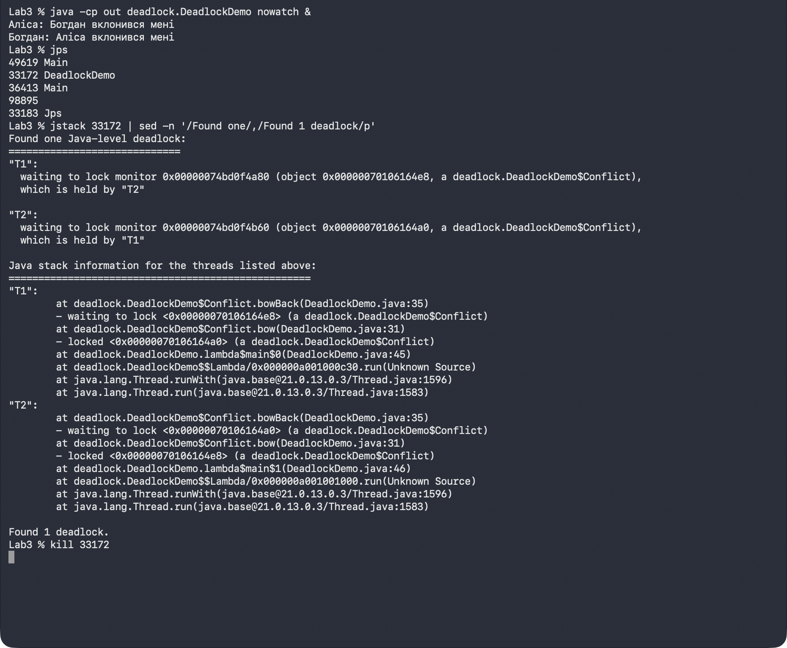
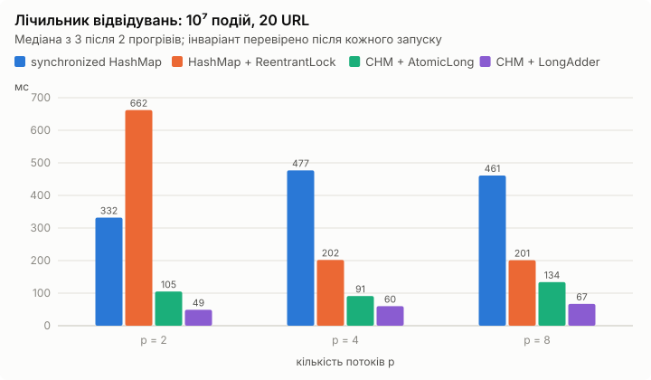
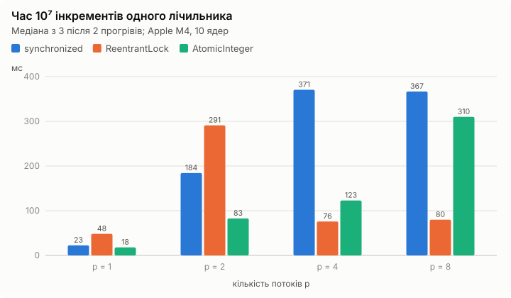

# Синхронізація потоків у Java

Що відбувається, коли кілька потоків одночасно змінюють спільні дані, і як це виправити. Проєкт по кроках відтворює типові конфлікти — втрачені оновлення, взаємне блокування, помилки координації — і порівнює засоби синхронізації Java за надійністю, швидкодією та складністю.

Прикладна задача — **лічильник відвідувань веб-сторінок**: потоки реєструють відвідування випадкових URL, і сума всіх лічильників має дорівнювати кількості подій. Наївна версія на `HashMap` губить ~15 % відвідувань; потокобезпечні — на `synchronized`, `ReentrantLock`, `ConcurrentHashMap` з `AtomicLong` і `LongAdder` — не гублять жодного, але відрізняються за швидкістю у 7–8 разів.

Java 17+, без сторонніх бібліотек.

## Що всередині

| Пакет | Клас | Що показує |
|---|---|---|
| `race` | `RaceDemo` | Втрачені оновлення: два потоки по 5 інкрементів дають 5 замість 10 |
| `locks` | `SyncMethodsDemo` | `synchronized`-методи: правильно, але потоки йдуть строго по черзі |
| | `SeparateLocksDemo` | Окремі об'єкти-замки для незалежних лічильників — удвічі швидше за спільний `this` |
| | `TryLockDemo` | `ReentrantLock.tryLock(таймаут)`: операції пропускаються, але програма не зависає |
| | `AtomicDemo` | `incrementAndGet()` атомарний, а `get()` + `set()` — ні |
| `deadlock` | `DeadlockDemo` | Класичний deadlock `bow`/`bowBack`, фіксація через `ThreadMXBean` або `jstack` |
| | `LockOrderingDemo` | Усунення впорядкуванням замків (порушує «циклічне очікування») |
| | `TryLockBackoffDemo` | Усунення `tryLock` з випадковим відступом (порушує «утримання та очікування») |
| `coordination` | `ProducerConsumerDemo` | Обмежений буфер на `wait()`/`notifyAll()` і три навмисні помилки: `if` замість `while`, `notify()`, `put` без `synchronized` |
| | `BlockingQueueDemo` | Та сама задача на `ArrayBlockingQueue` з «отруйною пігулкою» |
| `variant` | `WebVisitsDemo` | Лічильник відвідувань: наївна і 4 потокобезпечні версії, перевірка інваріанта, заміри |
| | `CounterBench` | Спільний стенд: 10⁷ інкрементів через `synchronized`, `ReentrantLock`, `AtomicInteger` |

**Перевірка коректності.** Кожен потік бере номери URL зі свого `Random(42 + номер)`, тому еталонну кількість відвідувань кожного URL можна порахувати послідовно. Після кожного запуску перевіряється і сума, і кожен лічильник окремо. У виробнику–споживачі сума всіх чисел має дорівнювати 2 · N(N+1)/2, у стенді — кінцеве значення лічильника кількості операцій.

**Методика вимірювань.** Пул з p потоків, без `sleep()`, 2 прогрівальні запуски (JIT), потім медіана з 3.

## Запуск

```bash
javac -d out $(find src -name '*.java')
```

```bash
java -cp out race.RaceDemo                          # втрачені оновлення
java -cp out deadlock.DeadlockDemo                  # deadlock + сторожовий потік
java -cp out coordination.ProducerConsumerDemo if   # помилка: if замість while
java -cp out variant.WebVisitsDemo                  # інваріант для всіх версій
java -cp out variant.WebVisitsDemo bench            # заміри для p = 2, 4, 8
java -cp out variant.CounterBench                   # стенд для p = 1, 2, 4, 8
```

Аргументи кожної програми описані на початку її файлу. Зафіксувати deadlock без сторожа:

```bash
java -cp out deadlock.DeadlockDemo nowatch &
jps
jstack <pid>    # розділ «Found one Java-level deadlock»
```



## Результати





<details>
<summary>Таблиці вимірювань</summary>

Apple M4 (4 продуктивні + 6 енергоефективних ядер), 16 ГБ, macOS 27, OpenJDK 21.

**Лічильник відвідувань**, 10⁷ подій, 20 URL:

| Реалізація | p = 2 | p = 4 | p = 8 | Інваріант |
|---|--:|--:|--:|:--|
| `synchronized HashMap` | 332 мс | 477 мс | 461 мс | OK |
| `HashMap` + `ReentrantLock` | 662 мс | 202 мс | 201 мс | OK |
| `ConcurrentHashMap` + `AtomicLong` | 105 мс | 91 мс | 134 мс | OK |
| `ConcurrentHashMap` + `LongAdder` | 49 мс | 60 мс | 67 мс | OK |
| наївна (`HashMap` без синхронізації), 10⁶ подій | | | | втрачено 148 579 |

**Один лічильник**, 10⁷ інкрементів:

| Механізм | p = 1 | p = 2 | p = 4 | p = 8 | Кінцеве значення |
|---|--:|--:|--:|--:|--:|
| без синхронізації | 0,4 мс | 0,3 мс | 0,3 мс | 0,4 мс | 3 834 040 ✗ |
| `synchronized` | 22,5 мс | 184,3 мс | 370,6 мс | 366,6 мс | 10 000 000 |
| `ReentrantLock` | 48,3 мс | 291,0 мс | 75,9 мс | 79,9 мс | 10 000 000 |
| `AtomicInteger` | 17,9 мс | 82,7 мс | 122,8 мс | 310,0 мс | 10 000 000 |

**Навмисні помилки виробника–споживача** (2 виробники, 2 споживачі, N = 10 000):

| Помилка | Наслідок |
|---|---|
| `if` замість `while` | споживачі падають з `NullPointerException` — забирають елемент з порожнього буфера |
| `notify()` замість `notifyAll()` (місткість 1) | зависання: усі 4 потоки `WAITING` |
| `put` без `synchronized` | `IllegalMonitorStateException`, споживачі чекають вічно |

Повний вивід усіх програм — у [results/output](results/output), таблиці — у [results](results), скріншоти — у [docs/screenshots](docs/screenshots).

</details>

## Висновки

- **Гонка — не рідкість, а норма.** Без синхронізації два потоки з 5 інкрементами стабільно дають 5 замість 10, а лічильник відвідувань губить ~15 % подій. Програма при цьому не падає — помилку видно лише з перевірки інваріанта.
- **Атомарний клас не робить атомарною послідовність.** `incrementAndGet()` коректний, а `get()` + `set()` на тому самому `AtomicInteger` знову губить оновлення.
- **Час зростає з кількістю потоків, хоча робота фіксована.** Операції над одним лічильником послідовні за природою; додаткові потоки додають лише передачу замка, невдалі CAS-спроби і пересилання рядка кешу між ядрами. Найшвидше — один потік.
- **Під сильною конкуренцією виграють структури без єдиної «гарячої» точки.** `ConcurrentHashMap` + `LongAdder` у 7–8 разів швидший за `synchronized HashMap`: таблиця не має глобального замка, а `LongAdder` розносить лічильник по кількох комірках.
- **Deadlock усувається порушенням однієї з умов Коффмана** — глобальним порядком захоплення замків або `tryLock` з випадковим відступом. Виявляти його краще `jstack` чи `ThreadMXBean`, а не «на око».
- **Координацію краще будувати на `BlockingQueue`.** Кожна з трьох типових помилок у ручному `wait()`/`notifyAll()` призводить до падіння або зависання; готова черга прибирає їх усі.

## Структура

```
src/race/          втрачені оновлення
src/locks/         synchronized, окремі замки, ReentrantLock, AtomicInteger
src/deadlock/      deadlock і два способи усунення
src/coordination/  виробник–споживач: wait/notifyAll, помилки, BlockingQueue
src/variant/       лічильник відвідувань і стенд вимірювань
results/           таблиці вимірювань і вивід усіх програм
docs/              графіки та скріншоти для README
```
